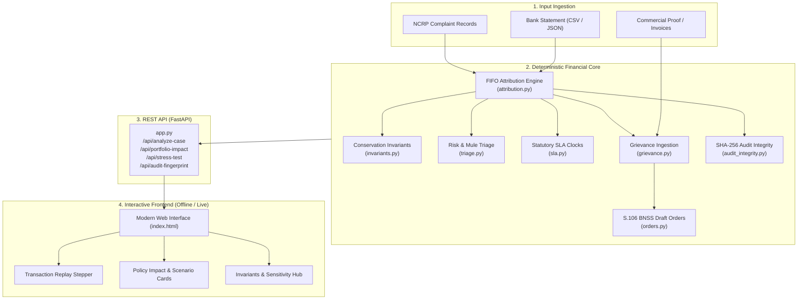

# ⚖️ Mercy Ledger

> **Freeze the fraud. Free the innocent.**  
> *A Right-Sized Cyber Fraud Lien & Restitution Decision-Support System.*

[](https://www.python.org/)
[](https://fastapi.tiangolo.com/)
[](#-verification--testing)
[](#-verification--testing)
[](#-conservation-invariants--integrity)
[](#-verification--testing)
[](#-system-architecture)

---

## 🏛️ Executive Summary & Problem Statement

Across India, cyber-fraud reporting via the **National Cybercrime Reporting Portal (NCRP)** and **Citizen Financial Cyber Fraud Reporting & Management System (CFCFRMS)** currently relies on blunt, blanket account freezes. When cyber-fraud proceeds touch an intermediary account, law enforcement notices (under Section 91/94 of CrPC / BNSS) frequently result in banks locking the accountholder's **entire balance and digital channels**.

This blunt mechanism devastates legitimate businesses, merchants, and ordinary citizens whose accounts happen to receive small fractional payments in the course of normal trade. Working capital is immobilized for months, payroll fails, and severe backlogs overwhelm bank grievance cells and magistrates.

**Mercy Ledger** solves this dilemma by operationalizing **proportionate, evidence-grounded lien accounting**:
- **Mathematical Attribution Engine**: Traces disputed inflows against subsequent transactions using rigorous chronological First-In, First-Out (FIFO) and pro-rata commingled attribution (MHA/I4C SOP Annexure-V).
- **Proportionate Lien Containment**: Distinguishes tainted funds from clean operating capital, ring-fencing victim restitution while freeing innocent funds.
- **Rule-Based Triage Scorecard**: Identifies rapid pass-throughs, mule layering velocities, and documentation gaps without arbitrary black-box AI decisions.
- **Statutory SLA & Deadline Clocks**: Tracks Section 106 CrPC / BNSS milestones, 15-day bank completion windows, and proposed 45-day review checkpoints.
- **Automated S.106 Judicial Draft Orders**: Generates court-ready restoration orders and merchant grievance compliance packages for authorized officer review.
- **Cryptographic Audit Trail**: Computes deterministic SHA-256 case fingerprints ensuring tamper-evident chain of custody.

---

## 🏗️ System Architecture



---

## 📚 Authoritative Regulatory, Forensic & Legal Foundations

Mercy Ledger is grounded in five authoritative institutional, regulatory, and academic frameworks:

1. **Bureau of Police Research & Development (BPR&D), MHA, GoI**  
   *“Challenges in Tracing Money Trail in Cyber Fraud and Way Forward”* ([BPR&D Compendium](https://bprd.mha.gov.in/uploads/pdf/Compendium_11zon.pdf))  
   *Operationalizes multi-layer mule account tracking, rapid IMPS/UPI layering mitigation, and transitioning from blanket S.91/S.94 freezes to surgical lien containment.*

2. **Reserve Bank of India (RBI)**  
   *Master Directions on Fraud Risk Management, 2024* (RBI/DOR/2024-25/118 et seq.)  
   *Operationalizes automated Transaction Monitoring Systems (TMS), velocity risk triggers, mule account governance, and avoiding unwarranted denial of service to genuine customers.*

3. **IIBF & National Forensic Sciences University (NFSU)**  
   *“Red Flags and Hidden Trails: Forensic Accounting in Asset Tracing and Cyber Fraud”* by Dr. Himanshu D. Thakkar & Saptarshi Datta (*BankQuest*, April–June 2025; [IIBF Publication](https://www.iibf.org.in/documents/BankQuest/2025/April-June%202025/4.%20Red%20Flags%20and%20Hidden%20Trails%20Forensic%20Accounting%20-%20Dr%20Himanshu%20D%20Thakkar%20and%20Saptarshi%20Datta.pdf))  
   *Operationalizes foundational tracing doctrines in commingled accounts: Clayton's Case (FIFO), Hallett's Estate (clean-first preservation), Sinclair v. Brougham (pari passu pro-rata restitution), and the Lowest Intermediate Balance Rule (LIBR).*

4. **United Nations Office on Drugs and Crime (UNODC / StAR)**  
   *Financial Investigation and Asset Tracing Guide* ([UNODC StAR](https://www.unodc.org/))  
   *Operationalizes the Principle of Proportionality in provisional restraint, protection of bona fide third parties, and tamper-evident chain of custody.*

5. **Ministry of Home Affairs / I4C Operational SOP**  
   *Standard Operating Procedure for NCRP-CFCFRMS, Custody, Restoration & Grievance Redressal* (2 January 2026; [`references/SOP_NCRP_CFCFRMS_2026-01-02.pdf`](references/SOP_NCRP_CFCFRMS_2026-01-02.pdf))  
   *Operationalizes direct vs. pro-rata attribution (Annexure-V) and statutory Section 106(3) BNSS restoration compliance.*

For in-depth legal analysis and statutory mapping, see [`docs/REFERENCES.md`](docs/REFERENCES.md).

---

## 📁 Repository Structure

```
mercy_ledger/
├── app.py                         # FastAPI web server and REST endpoints
├── attribution.py                 # Core FIFO & pro-rata attribution engine (protected baseline)
├── audit_integrity.py             # SHA-256 tamper-evident case hashing & verification
├── benchmark.py                   # Performance benchmark (< 1 ms / case execution guard)
├── chain.py                       # Multi-hop synthetic fund flow tracker & visualizer
├── check_my_work.py               # Golden-fixture acceptance checker for all modules
├── grievance.py                   # Inactive/active merchant invoice verification
├── impact.py                      # Portfolio economic impact metrics (innocent funds freed)
├── invariants.py                  # Formal accounting conservation invariants & LIBR proofs
├── make_sample_data.py            # Offline frontend dataset generator (static/sample_data.js)
├── orders.py                      # Statutory court orders generator (S.106 CrPC / BNSS)
├── pipeline.py                    # End-to-end case analysis & portfolio orchestration
├── presets.py                     # Built-in demonstration presets (SOP_ILL_1, SOP_ILL_2, etc.)
├── requirements.txt               # Production dependencies (FastAPI, Uvicorn)
├── review_flags.py                # Forensic review flags (hold gaps, dwell times, pass-throughs)
├── sensitivity.py                 # Assumption sensitivity: Clayton vs. Hallett vs. Pro-Rata
├── simulator.py                   # Seeded synthetic case generator (deterministic)
├── sla.py                         # Statutory SLA clocks & procedural deadline warnings
├── stress_test.py                 # High-volume Monte-Carlo invariant stress test
├── test_*.py                      # Unit test suites (Priority 1, 2, and 3 suites)
├── triage.py                      # Transparent triage recommendation scorecard
├── victim_explainer.py            # Plain-language victim audit statements & explanations
│
├── golden/                        # Ground-truth verified fixtures (SOP_ILL_1, MERCHANT_200, etc.)
├── references/                    # Primary source documentation (Official MHA/I4C SOP PDF)
├── static/                        # Frontend UI (index.html), CSV test datasets, sample cache
└── docs/                          # Comprehensive technical documentation, rules, & prompts
    ├── 00_RULES_FOR_EVERY_AI.md   # Determinism & precision rules
    ├── 01_DATA_CONTRACT.md        # Canonical JSON schema contract
    ├── JUDGE_QA_MASTER.md         # Master judge Q&A and regulatory justification
    ├── REFERENCES.md              # Authoritative reference guide & legal matrix
    ├── Mercy_Ledger_Technical_Report_v2.pdf # Formal engineering report
    ├── priority_1/                # Core MVP prompts & specifications
    ├── priority_2/                # Judge-visible depth prompts & specifications
    └── priority_3/                # Stretch capability prompts & specifications
```

---

## 🚀 Quickstart

### 1. Requirements & Installation
Mercy Ledger uses Python 3.10+ standard library for all financial mathematics (`Decimal`, no float rounding errors). Only `fastapi` and `uvicorn` are required:

```bash
git clone https://github.com/RJsr-08/Mercy-Ledger.git
cd Mercy-Ledger
pip install -r requirements.txt
```

### 2. Launch the Application
Start the server using either method:

```bash
# Option A: Direct Python execution
python app.py

# Option B: Uvicorn with auto-reload
python -m uvicorn app:app --host 127.0.0.1 --port 8000 --reload
```

Open your browser at **`http://127.0.0.1:8000`** to access the interactive web application.

---

## 🧪 Verification & Testing

Mercy Ledger comes with a multi-layered verification suite:

### 1. Acceptance Gate Check
```bash
python check_my_work.py all
```
Verifies all 7 backend modules (`attribution`, `simulator`, `triage`, `sla`, `impact`, `grievance`, `orders`) and the whole-system pipeline against ground-truth golden fixtures.

### 2. Comprehensive Unit Test Suite
```bash
python -m unittest discover -p "test_*.py"
```
Executes all 43 unit tests covering:
- Formal Conservation Invariants (`test_priority2_invariants.py`)
- Forensic Review Flags (`test_priority2_review_flags.py`)
- Plain-Language Victim Explainer (`test_priority2_explainer.py`)
- Multi-Hop Chain Tracking (`test_priority3_chain.py`)
- Assumption Sensitivity Engine (`test_priority3_sensitivity.py`)
- Cryptographic Audit Fingerprints (`test_priority3_audit_integrity.py`)

### 3. High-Volume Invariant Stress Testing
```bash
python -c "import stress_test; print(stress_test.run_stress_test(40, seed=7))"
```
Simulates 40 randomized multi-victim cases with seed 7, asserting 100% mathematical conservation across every single transaction.

### 4. Performance Benchmark
```bash
python benchmark.py
```
Validates analysis throughput over 200 consecutive case evaluations (typical performance: ~0.28 ms/case, safely within the < 50 ms budget).

---

## 📡 API Reference

| Endpoint | Method | Description |
| :--- | :--- | :--- |
| `/api/health` | `GET` | System health check (`{"ok": true}`). |
| `/api/presets` | `GET` | List all available demonstration presets. |
| `/api/presets/{preset_id}` | `GET` | Fetch specific preset case data. |
| `/api/analyze-case` | `POST` | Execute full pipeline analysis for a case or preset. |
| `/api/portfolio-impact` | `GET` | Monte-Carlo simulation quantifying aggregate economic relief. |
| `/api/analysis-extras/{id}`| `GET` | Retrieve invariants, review flags, and victim explanations. |
| `/api/stress-test` | `GET` | Run on-demand invariant stress test (parameters: `n`, `seed`). |
| `/api/sensitivity/{id}` | `GET` | Compare Disputed-First vs. Clean-First vs. Pro-Rata models. |
| `/api/chain-demo` | `GET` | Execute multi-hop synthetic fund propagation analysis. |
| `/api/audit-fingerprint` | `POST` | Generate or verify SHA-256 tamper-evident case digests. |

---

## ⚖️ Scope & Disclaimers

1. **Decision Support Only**: Mercy Ledger is a deterministic decision-support instrument. Draft orders and lien calculations are prepared for review by authorized judicial magistrates, police officers, and bank nodal officers.
2. **Synthetic Data**: Demonstration ledgers and multi-hop scenarios are synthetic and designed for architectural evaluation. A transaction pattern is not proof of criminal guilt.
3. **No Direct Production Integrations**: The prototype does not claim live bank core-banking system (CBS) connectivity or production CFCFRMS API access.
